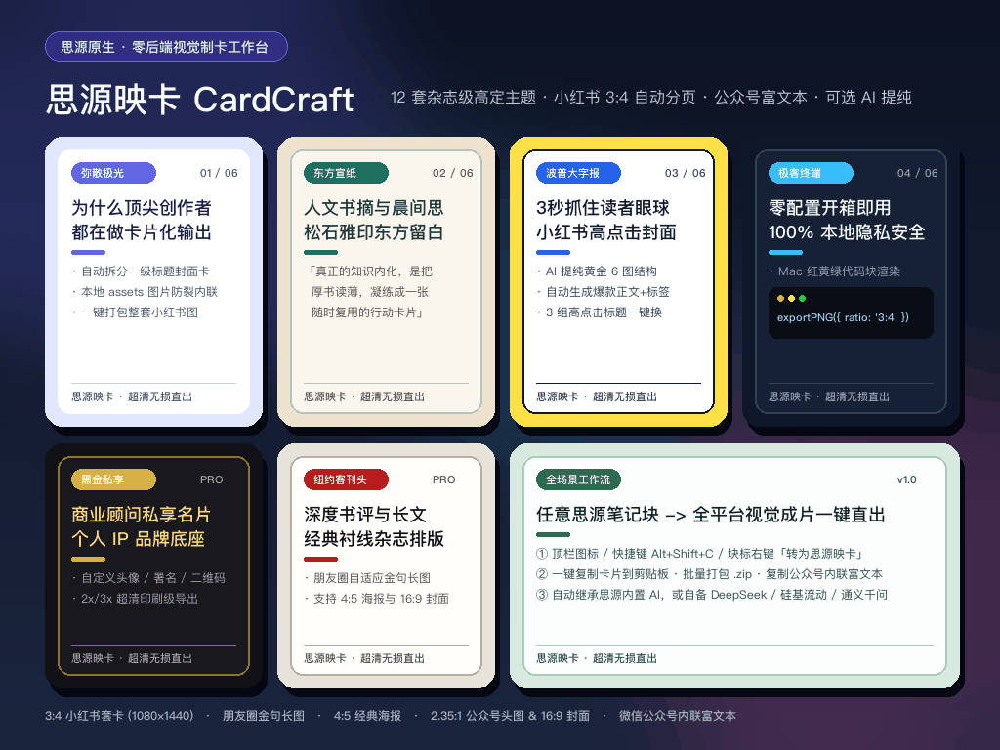

# CardCraft · Visual Card & Social Publishing Studio for SiYuan (`siyuan-cardcraft`)

[中文文档](./README.zh-CN.md)

**CardCraft (思源映卡)** is a 100% native, zero-backend, privacy-first visual card & social publishing studio inside SiYuan Note. Turn any note or selected blocks into **magazine-grade Xiaohongshu (`3:4`) multi-card carousels, Moments/X long quote cards, `4:5` classic posters, `2.35:1` / `16:9` article covers, and WeChat Official Account inline-styled rich text** in seconds.

---

## ✨ Key Highlights

### 1. Three Effortless Entry Points
- **Top Bar Icon & Global Shortcut (`⌥⇧C` / `Alt+Shift+C`)**: Launch the dual-column studio immediately from your active SiYuan document.
- **Block Context Menu (`🎨 Send to CardCraft`)**: Click any block icon (single block or multi-block selection—paragraphs, quotes, lists, code blocks, or local `assets/` images) and send directly to CardCraft.

### 2. Four Social Aspect Ratios & Smart Long-Form Pagination
- **📱 Xiaohongshu Golden Carousel (`3:4`, `1080×1440` HD)**: Automatically transforms `# Title` into a high-impact **01 Cover Card** and splits `## Sections` (with smart height/character overflow protection) into cohesive body cards (`01 / 06`, `02 / 06`...).
- **🧧 Moments / Quote Long Card (`Auto Height`, `1080px` width)**: Seamless single-scroll card without clipping.
- **🖼️ Classic Poster (`4:5`, `1080×1350`)**: Ideal for book excerpts and structured insights.
- **🖥️ Article & Video Covers (`2.35:1` WeChat Header `1080×460` & `16:9` Cover `1280×720`)**: Extracts title + customizable top capsule badge for instant cover graphics.

### 3. 12 Magazine-Grade Bespoke Visual Themes
Crafted with editorial typography, balanced whitespace, subtle textures, Mac 🔴🟡🟢 code headers, and automatic Base64 inlining for SiYuan `/assets/...` images:
- **🆓 Free Forever (3 Themes)**:
  1. **Pure Ceramic (`pure-ceramic`)** — Minimalist warm-gray canvas with floating crisp white card.
  2. **Apple Notes (`apple-notes`)** — Classic warm ivory texture with amber accent header & timestamp.
  3. **Geek Dark Terminal (`mac-dark`)** — Deep space navy gradient with macOS traffic-light glass card.
- **💎 Pro Lifetime Exclusive (9 Themes)**:
  4. **Oriental Xuan & Pine (`oriental-xuan`)** — New-Chinese rice paper & pine-turquoise seal aesthetics.
  5. **New Yorker Editorial (`newyorker-serif`)** — Ivory editorial layout with bold masthead rule & classic serif typography.
  6. **Aurora Frosted Glass (`aurora-glass`)** — Diffused violet-cyan mesh glow with translucent frosted card.
  7. **Pop High-CTR Poster (`pop-poster`)** — Warm electric yellow & cobalt high-contrast creator style.
  8. **McKinsey Deep Blue (`mckinsey-blue`)** — Executive navy header with crisp gold analytical accents.
  9. **Retro Film Memo (`film-memo`)** — Warm espresso vignette with creamy film grain tones.
  10. **Forest Breath Mint (`forest-mint`)** — Morning sage gradient for calm, healing notes.
  11. **Sunset Amber Glow (`sunset-amber`)** — Golden-hour apricot radiance with warm editorial contrast.
  12. **Black Gold Private (`black-gold`)** — Obsidian dark canvas with champagne-gold hairline frame.

### 4. Dual Export Engine: HD PNGs (`.zip`) + WeChat Rich Text
- **📋 One-Click Copy Card PNG** directly to system clipboard (`Ctrl/Cmd+V` into WeChat, Xiaohongshu Web, Slack, etc.).
- **💾 Single HD PNG & 📦 One-Click `.zip` Batch Export**: Pure frontend 2x/3x supersampled rasterization + built-in zero-dependency ZIP packager (`01_Cover.png`, `02_Body.png`...).
- **💚 WeChat Official Account Rich-Text Tab**: Copies 100% compatible inline-CSS HTML directly into `mp.weixin.qq.com`.

### 5. Zero-Config Ready + Optional AI Smart Distillation (BYOK)
- Works **100% offline out-of-the-box** with zero API keys required.
- Optional **AI Smart Distillation** (auto-inherits SiYuan's built-in OpenAI/DeepSeek settings or custom DeepSeek / SiliconFlow / Qwen / Kimi / OpenAI / Ollama endpoints):
  - **✨ Distill into 6-Card Xiaohongshu Suite** (generates `1 Cover + 4~5 Core Cards + 1 Summary Card` + ready-to-post Xiaohongshu caption & `#hashtags`).
  - **🎯 3 High-CTR Viral Cover Titles**.
  - **💡 Extract Top 3 Golden Quotes**.

---

## 🔒 Privacy & Offline Architecture
- **100% Local Rendering**: Markdown parsing, `/assets/` image Base64 embedding, Canvas HD export, ZIP packaging, and Ed25519 license verification all run locally inside your SiYuan client.
- **BYOK AI**: Optional AI requests go directly from your device to your chosen model endpoint.

## 📄 License
MIT License © 2026 lsqingfeng
