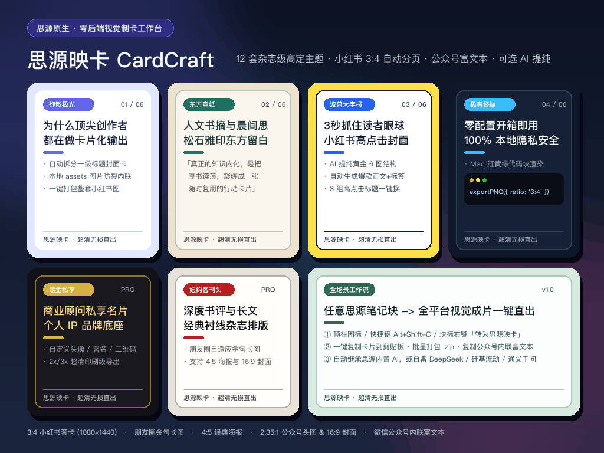

# 思源映卡 CardCraft (`siyuan-cardcraft`)

[English Documentation](./README.md)

**思源映卡 (CardCraft)** 是一款 **100% 纯思源原生、零浏览器插件、零后端服务器依赖** 的高颜值知识制卡与社媒图文排版工作台。无需离开思源笔记，一键将当前文档或任意选中的笔记块转化为 **小红书 `3:4` 自动分页多图套卡、朋友圈自适应金句长图、`4:5` 经典海报、公众号/B站封面头图，以及微信公众号 100% 兼容内联富文本**。

> 💎 **首发早鸟 ¥29.9 终身买断（原价 ¥49 · 纯离线 Ed25519 授权 · 24h 自动发卡）**  
> 🛒 **立即获取 Pro 终身激活码（爱发电直达）**：[https://afdian.com/item/79927f0ee0b011f1a7a152540025c377](https://afdian.com/item/79927f0ee0b011f1a7a152540025c377)

*▲ 首屏效果预览：支持直接将思源长笔记与 `/assets/` 本地插图一键排成杂志感多图套卡、长金句海报及公众号富文本，零裂图、零外部软件切换。*

---

## ✨ 核心亮点

### 1. 三大丝滑触发入口
- **顶栏图标 + 全局快捷键 (`⌥⇧C` / `Alt+Shift+C`)**：一键唤起《思源映卡 · 视觉制卡工作台》双栏实时预览弹窗，自动载入当前打开文档。
- **块标右键菜单 (`🎨 转为思源映卡`)**：点击任意段落、引述块、列表、代码块或图片块左侧块标（支持框选多个块），精准提取选中内容（含本地 `/assets/` 图片自动转 Base64 内联防裂图）直达制卡台！

### 2. 四大社媒黄金画幅 + 小红书智能分页引擎
- **📱 小红书黄金竖版 (`3:4`，`1080×1440` 超清)**：自动将 `# 一级标题` + 导语渲染为极具视觉张力的 **「01 大字报封面卡」**，并按 `## 二级标题` 及字数高度阈值智能切分为多张同色系正文套卡，自动标注精致页码 `01 / 06`、`02 / 06`。
- **🧧 朋友圈 / 即刻金句长卡 (`自适应高度`，宽 `1080px` 超清)**：单张完整长图不裁切，书摘灵感秒发朋友圈。
- **🖼️ 经典知识海报 (`4:5`，`1080×1350`)**：兼顾信息密度与留白呼吸感。
- **🖥️ 公众号 / B站专栏封面图 (`2.35:1` 微信头图 `1080×460` & `16:9` 封面 `1280×720`)**：自动提取主标题 + 顶部胶囊标语，告别繁琐作图工具。

### 3. 12 套杂志级高定视觉主题（拒绝粗糙程序员边框风）
精调留白呼吸感、字重对比、圆角阴影、Mac 🔴🟡🟢 代码窗口头与装饰角标：
- **🆓 免费社区版永久开放（3 套）**：
  1. **极简瓷白 (`pure-ceramic`)**：温润浅灰底 + 纯白悬浮圆角卡 + 克制深灰排版
  2. **苹果备忘录 (`apple-notes`)**：经典暖白纸纹 + 顶部琥珀黄横条与时间轴印记
  3. **极客暗夜终端 (`mac-dark`)**：深空黑蓝渐变 + Mac 红黄绿三色圆点毛玻璃卡片
- **💎 Pro 终身专业版专属（9 套）**：
  4. **东方宣纸松石 (`oriental-xuan`)**：新中式米金宣纸肌理 + 松石青绿竖排印章装饰，人文书摘绝配
  5. **纽约客刊头 (`newyorker-serif`)**：高级象牙白 + 经典粗黑顶线 + 衬线体杂志评论风
  6. **弥散极光毛玻璃 (`aurora-glass`)**：紫青柔光弥散渐变 + 半透明磨砂白卡，AI 科技资讯爆款
  7. **荧光波普大字报 (`pop-poster`)**：高对比暖黄与电光蓝撞色大字封面风，小红书高点击率利器
  8. **商业研报深蓝 (`mckinsey-blue`)**：深海蓝刊头 + 严谨香槟金指标线，适合职场方法论拆解
  9. **复古胶片手账 (`film-memo`)**：暖棕暗角胶片质感 + 柔和奶油字色
  10. **森系呼吸薄荷 (`forest-mint`)**：清晨鼠尾草绿渐变 + 治愈系留白排版
  11. **落日琥珀流光 (`sunset-amber`)**：暖橙杏色柔和日落光晕 + 杂志感标题层次
  12. **黑金私享名片 (`black-gold`)**：曜石黑底 + 香槟金细框与流光字，高端商业顾问风

### 4. 纯前端超清 PNG 批量打包 + 公众号富文本双输出
- **📋 一键复制当前卡片到剪贴板**：无需落地保存文件，直接在微信、小红书网页版、飞书中粘贴发送。
- **💾 单张高清 PNG 下载 & 📦 一键 `.zip` 批量导出整套小红书图片**：内置纯前端零依赖超清光栅化与 ZIP 打包器，按 `01_封面.png`、`02_正文.png` 顺序整齐归档。
- **💚 一键复制公众号内联排版富文本**：切换至公众号预览视图，一键复制 100% 适配微信公众号后台的内联样式富文本。

### 5. 双模引擎：零配置开箱即用 + 可选 AI 智能提纯套卡
- **基础模式（零配置）**：不填任何 API Key 即可离线完成全部 Markdown 排版、智能分页与超清导图。
- **AI 提纯模式（BYOK 自备 Key / 自动继承思源内置 AI）**：自动检测并继承思源「设置 -> AI」配置，也支持在插件内独立配置 DeepSeek、硅基流动、通义千问、Moonshot Kimi、OpenAI 或本地 Ollama：
  - **✨ AI 提纯为小红书黄金 6 图套卡**：万字长笔记一键浓缩为 `1 张吸睛封面 + 4~5 张精炼干货卡 + 1 张行动总结卡`，并附赠配套小红书爆款正文与 `#标签` 一键复制！
  - **🎯 AI 爆款封面标题改写**：一键生成 3 组高点击率主副标题候选，点击即刻换装。
  - **💡 AI 提取全文 3 大金句**：自动提炼全文最具传播力的 3 句精华，一键切换金句长卡。

---

## 💎 免费版 vs Pro 终身专业版

| 权益项 | 🆓 免费社区版 | 💎 Pro 终身版（首发早鸟 ¥29.9 / 原价 ¥49） |
| :--- | :--- | :--- |
| **高定视觉主题** | 永久开放前 3 套经典主题 | **解锁全部 12 套杂志级高定主题 + 字号/边距精细微调** |
| **单卡制作与剪贴板复制** | 不限次数免费使用 | 不限次数免费使用 |
| **小红书多图分页与导出** | 每次最多导出前 3 张 | **无限张数长文智能分页 + 一键 `.zip` 批量打包导出** |
| **卡片底部品牌区** | 含克制小字「由 思源映卡 渲染」 | **去除水印 + 解锁「个人 IP 品牌底座」(自定义头像/署名/二维码持久化)** |
| **AI 智能提纯套卡** | 免费赠送 **3 次** 体验额度 | **不限次数无限使用**（自备 API Key 或继承思源 AI） |
| **公众号富文本内联排版** | 基础主题内联复制 | **解锁全部 12 套高定色彩体系公众号内联排版** |

> 采用 **Ed25519 纯离线非对称公钥验签**，一次买断永久激活，无订阅费、不绑定设备数量，断网与局域网 Docker 环境均可毫秒级离线激活！

- 🛒 **获取 Pro 终身专业版激活码（爱发电 24h 自动发卡 · 微信/支付宝）**：[https://afdian.com/item/79927f0ee0b011f1a7a152540025c377](https://afdian.com/item/79927f0ee0b011f1a7a152540025c377)
- 🏪 **作者爱发电主页（更多独立效率插件与工具）**：[https://afdian.com/a/lsqingfeng](https://afdian.com/a/lsqingfeng)
- ⚡ **激活方法**：下单后在爱发电订单页或站内私信复制 `SYCC-PRO-...` 激活码 -> 思源内按 `⌥⇧C` 打开思源映卡 -> 点击右上角「💎 升级终身版」粘贴激活即可。

## 📄 开源协议
MIT License © 2026 lsqingfeng
